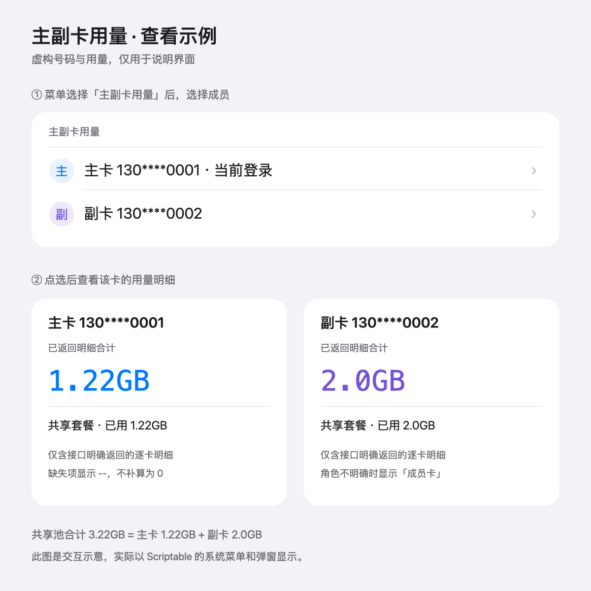
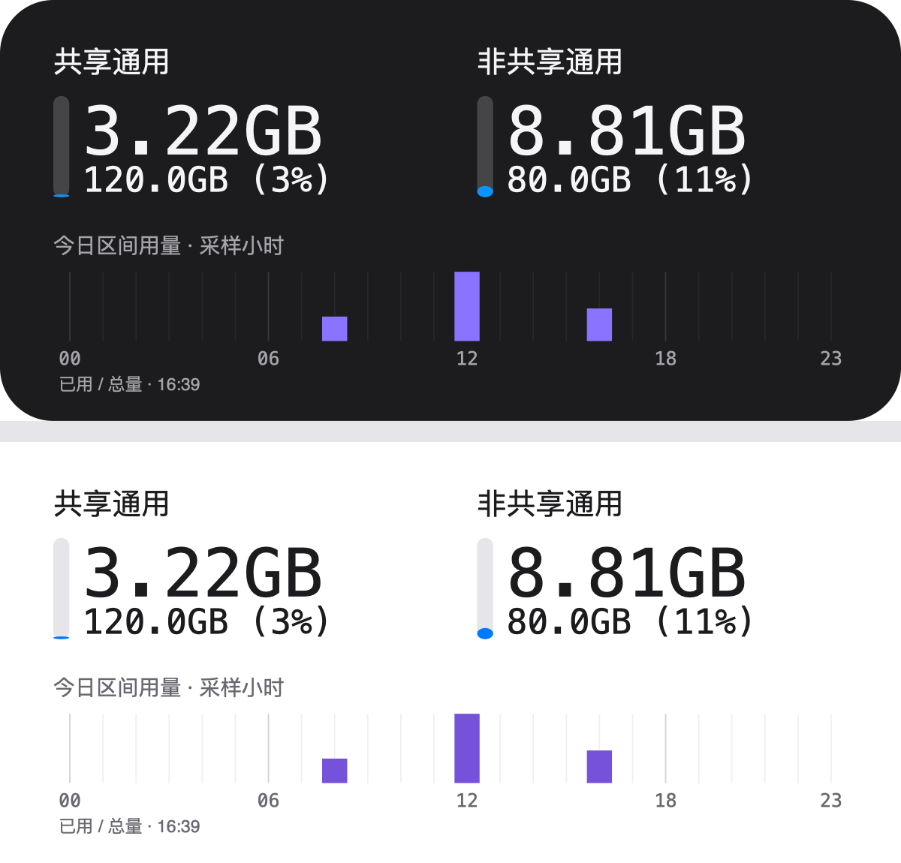
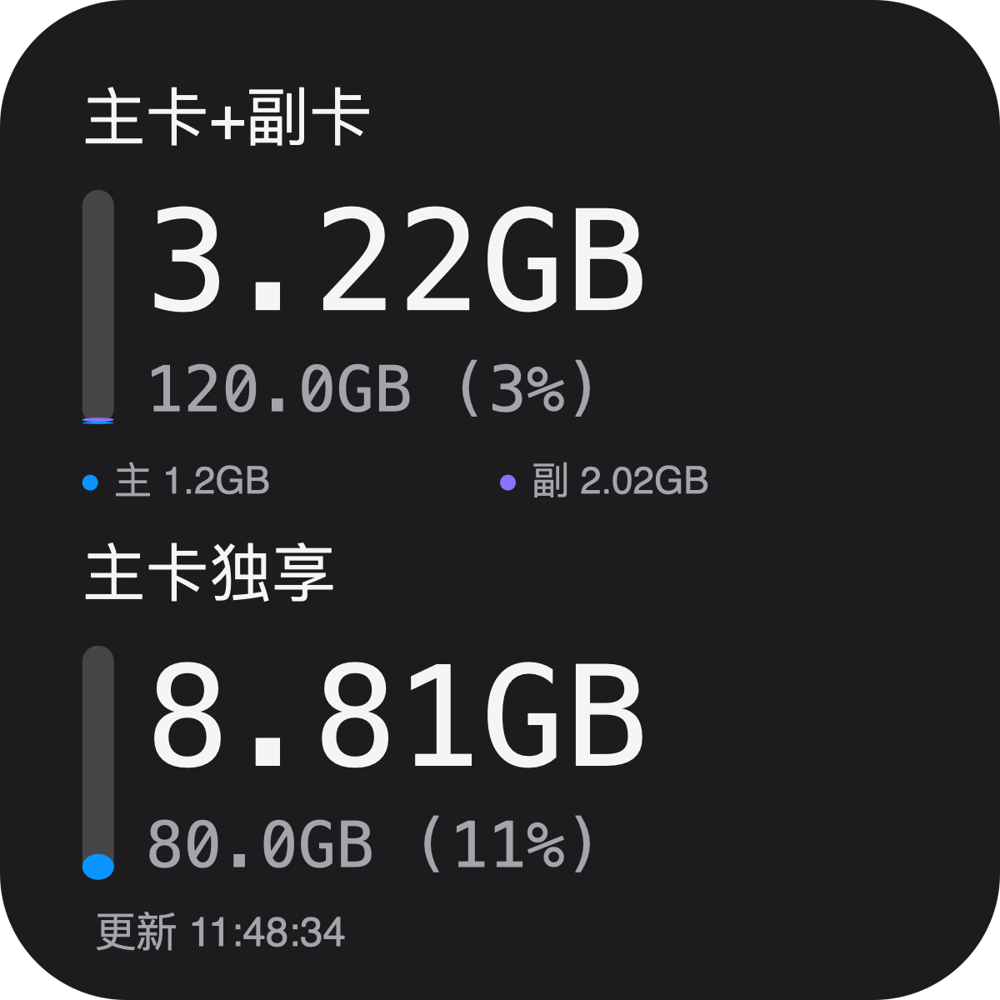
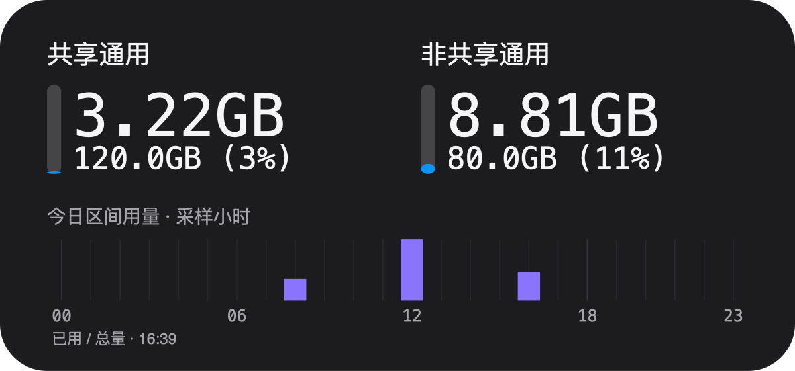

# 联通流量 · Scriptable

脚本：[UnicomFlow.js](../../scriptable/UnicomFlow.js)，依赖 `DmYY.js`。配置页沿用 `ChinaUnicom_2024` 的 DmYY 卡片分组和图标菜单；流量数据和图表独立实现。

## 安装

1. 确认 Scriptable 中已有 [DmYY.js](https://raw.githubusercontent.com/dompling/Scriptable/master/Scripts/DmYY.js)，与组件放在同一脚本目录。已安装 `ChinaUnicom_2024` 的用户通常已经有该依赖，无需重复安装。
2. 把 `scriptable/UnicomFlow.js` 的全部内容复制到 Scriptable 的新脚本，命名为“联通流量”。原来的组件可以保留。
3. 保持 QX、现有联通 Cookie 重写和 BoxJS 开启；Safari 应能打开 `http://boxjs.net`。
4. 如果还没有 Cookie，进入联通官方 App 首页的流量查询，收到写入成功通知。
5. 在 Scriptable 运行“联通流量”，在“预览组件”分组选择“小尺寸”或“中尺寸”。脚本直接请求 `http://boxjs.net/query/data/@YaYa_10010.cookie`，无需手动复制，也无需添加新的联通重写。
6. 核对数据后，桌面添加小号或中号 Scriptable 组件，编辑组件并选择“联通流量”。参数留空显示本月；需要今日视图时填写 `today`。

如果 BoxJS 使用其他域名，在“维护 → 高级设置 → BoxJS 域名”中修改，只填域名；默认沿用 DmYY 的全局 BoxJS 域名，未设置时使用 `boxjs.net`。Cookie 仍保存在 QX；组件每次刷新都读取指定字段，不使用 BoxJS 的批量应用列表，也不会在文件、日志或源码中保存 Cookie。

## 小组件参数：本月／今日

长按桌面组件 → 编辑小组件 → Parameter：留空或填写 `month` 保持月用量视图，填写 `today` 切换为今日视图。小号、中号均支持，每张组件独立选择，同一份历史和字体设置可以同时用于两种视图。组件不再提供独立刷新按钮，整卡点击行为遵循 Scriptable 自身设置。

今日视图标题为“共享流量 · 今日”／“主卡独享 · 今日”（未识别共享属性时沿用通用／定向分类），大数字显示该组套餐的今日已记录增量；下方固定使用 GB，格式如 `6.8 / 120 GB`，斜杠两侧和数字与单位间各留固定 2 点间距，不加“本月”文字、不显示百分比。竖条仍表示月套餐已用比例。图表只保留主卡／副卡色点和名称，不重复用量数字；共享池下方不再额外显示逐卡月用量。月视图继续显示月套餐信息，图表改为本月每日分布；两种模式的图例统一为“主卡／副卡”，不显示用量数字。

日用量直接复用原有同日区间记录，不另存套餐增量或今日累计值，不清空旧历史。当前账户此前主卡未使用共享池，且只显示共享／独享两类套餐：当共享主卡累计值仍确认为零时，原副卡增量对应共享池，原主卡增量对应主卡独享；独享包一直明确计入主卡，因此旧记录中未知成员归属的增量仍可合并到共享池。若主卡开始使用共享池、有其他分类混入或当前成员归属不完整，旧记录无法精确拆分，显示 `—`，不按比例猜测。单一套餐分类可直接复用总增量，确认总增量为零时各套餐也为零。上一版冗余的 `packageDeltas` 字段在正常保存历史时移除，其余原记录保留；新增零区间不会覆盖已有今日用量。无有效记录显示 `—`，真实零增量显示 `0 MB`；底部正常显示更新时间，不再附加“今日已记录”；数据缺失时保留“今日待采样”或“今日分类未确认”，查询失败仍优先显示缓存状态。符合阈值的跨午夜小流量近似归入对应日期，其余跨午夜区间不拆分到今日，长时间未刷新可能漏记；不是运营商详单。

## 配置菜单

在 Scriptable 内直接运行脚本先显示 DmYY 配置页。预览和统计页遵循共享缓存，菜单“立即刷新数据”和“连接检查”始终强制查询。桌面点击是否进入组件执行或 App 菜单取决于 Scriptable 的交互方式；只要执行组件渲染，就遵循相同的缓存规则。

- 预览组件：统一“组件预览”入口，同页上下展示小号、中号，可切换当月／今日；两种尺寸与模式共用一次加载结果，切换不额外查询，不修改桌面参数。
- 组件配置：脚本更新（首项）、组件主题（黑色／白色）、字体与字号、颜色配置、刷新设置（组件刷新间隔／数据请求间隔）。
- 用量与数据：用量统计（单日／单月／月度趋势，网页右上角可查看刷新记录）、刷新记录、立即刷新数据。
- 维护：重载组件、数据存储（总文件大小及文件明细；按最新套餐快照、刷新记录、小时用量记录、每日用量记录分别清除，或清除全部历史；保留确认）、高级设置（账户说明、BoxJS 域名、套餐分类、连接检查、成员字段检查）。

主菜单共12个入口；打开菜单、高级设置、刷新设置均不查询账户。预览复用共享缓存，无有效缓存时查询一次，失败有旧缓存则展示缓存，否则提示连接错误。DmYY 自动插入的分尺寸预览入口在本脚本配置页中过滤，不修改共享依赖。

“立即刷新数据”是直接读取 `@YaYa_10010.cookie` 后刷新套餐，不调用 DmYY 的批量导入方法；不把 Cookie 保存进 DmYY 设置。DmYY 只保存颜色、刷新间隔等界面配置。

## 脚本更新

首次安装使用[仓库原始脚本](https://raw.githubusercontent.com/42vio/quantumultx-scripts/main/scriptable/UnicomFlow.js)。

菜单“组件配置 → 脚本更新”直接下载并同步本仓库 `main/scriptable/UnicomFlow.js`。不比较版本号，不需要二次确认，不创建备份；内容相同时提示“已是最新”，不写入文件；只有内容变化且替换成功才提示“同步完成”。替换前检查文件标识和 JavaScript 语法，下载或校验失败时保留原文件。

自动识别本地或 iCloud 文件，脚本改名也能同步。写入后核对内容；如果写入失败，提示从仓库重新下载。主题和其他 DmYY 配置、历史快照、QX Cookie 不随同步清除。同步后关闭配置页、重新运行脚本。`DmYY.js` 不参与本菜单同步。

脚本保留一次旧客户端迁移所需的版本常量，方便已安装版本通过原菜单升级；新版同步功能不使用它，开发期间无需递增。

## 显示规则

独享流量优先：小号上方为主卡独享、下方为共享流量；中号左侧为主卡独享、右侧为共享流量。本月、今日两种模式顺序一致，通用／定向的回退顺序不变。

“组件配置 → 字体与字号”分别设置**用量文字**和**总量与百分比**，两组可以选择不同字体；每组只有一个字体菜单，选项为系统 Regular、系统 Medium、SF Mono Regular、SF Mono Medium、Menlo Regular。Menlo 没有原生 Medium，不作伪造或替代；不可用时回退系统等宽 Regular。选择菜单沿用 DmYY 普通文字，不提供字体预览。小号、中号共用设置，默认用量 SF Mono Medium 25 号、总量系统 Medium 11 号；直接输入数字（支持小数），用量允许 12—28，总量允许 6—14，超宽文字自动缩小以适应卡片，不改变保存的字号。旧数字字体设置自动迁移到两组字体；上一版完整默认组合会一次性切换到新默认，已自定义的组合保留，不清除历史。用量行略上移、总量行略下移，为 Medium 25 号留出间距。用量数字和总量从竖条右侧同一位置起排，MB／GB 单位与用量数字使用相同字体、字重、字号，以 2 点窄间距分隔，避免等宽字体普通空格过宽；超宽时数字和单位同步缩小。总量的数字与单位也采用固定 2 点窄间距，单位与百分比括号之间不加空格，例如 `120 GB(6%)`。主副卡说明使用系统常规字体，标题使用系统中等字重，小时／日期刻度保留等宽字体。“标题文字”另提供独立字号输入，大小号共用，允许 8—12（支持小数）；留空恢复小号10、中号11，长标题自动缩小以适应宽度。大数字表示已用，下方表示套餐总量和已用百分比，大小卡片统一使用数字左侧的竖进度条，从底部向上增长。主卡独享等普通套餐的竖条表示已用比例；共享池的整条高度代表套餐总量，底部蓝色段表示主卡已用、其上紫色段表示副卡已用，剩余灰色表示未用流量。例如共享总量 120 GB、主卡已用 1.2 GB、副卡已用 2.02 GB 时，两段合计只占整条约 2.68%。下方标明两张卡各自的共享用量，蓝色为主卡、紫色为副卡；主卡共享用量确认为 0 且逐卡合计完整时，小号与中号都省略这组图例，数据缺失时仍保留提示；成员缺失或合计不符时保留灰条并提示，不推算缺失用量。左右留白按 158 点设计高度收窄为 13 点，小号顶部为 12 点；共享条的彩色段同样使用圆头，短段按实际高度绘制椭圆圆角，不夸大用量；大小卡片底部均显示精确到秒的最后一次成功查询时间，小号、中号均不显示刷新图标、不设置单独的刷新点击区域，保留圆角安全留白。缓存或未识别明细的提示仍保留在安全区域内。不同手机尺寸统一按设计高度缩放布局。整卡使用背景图填满组件，避免固定宽度内容图片产生边缘细线；小时标签、竖线、柱子共用每格中心点对齐。在“组件配置 → 组件主题”选择黑色或白色，默认黑色，不随系统自动变化。两种主题分别保存自定义颜色，切换后文字、刻度、背景和提示颜色一起变化；可在“颜色配置”中调整当前主题。原版本的颜色设置仅迁移到黑色主题，避免白色主题套用旧的黑底配置。不限量套餐不计算百分比；没有返回某一类明细时显示 `--`，不伪装成 0。

脚本调用联通的套餐明细接口 `queryOcsPackageFlowLeftContentRevisedInJune`。其明细中的 `total/use/remain` 默认以 MB 计，明确带单位的数值按单位换算；不从首页汇总值推算通用／定向数据。

`mlresources`、代码 `40008` 以及名称中明确标注定向、免流、专享免费、畅视的流量包默认归为定向，其余可识别的普通流量包归为通用。日租包默认排除，套外计费资源不并入套餐。不同省份、活动套餐的分类可能不同，请在菜单“套餐分类”中核对，可把具体套餐改为共享通用、非共享通用、通用（自动识别）、定向或排除。

### 共享与非共享套餐

图示的两项都属于通用流量，不能把第二项标成定向：

| 分组 | 套餐 | 图示总量 | 图示已用 | 图示剩余 |
|---|---|---:|---:|---:|
| 共享通用 | 5G 畅爽冰激凌 199 元，含上月结转 | 120 GB | 3.22 GB | 116.78 GB |
| 非共享通用 | 政企 0 元 80 GB 国内通用流量包 | 80 GB | 8.81 GB | 71.19 GB |
| 通用合计 | 两项汇总 | 200 GB | 12.03 GB | 187.97 GB |

这些数值只用于说明和测试，不写死在组件中。组件按接口中的实际总量统计结转，不能再把截图中的上月 60 GB 手动加一次。

同时识别到共享与非共享两组时，小号上下、中号左右显示“共享流量／主卡独享”（分别对应共享通用池／主卡独享通用包）；否则保留“通用／定向”布局。接口 `unshared` 分区或 `unsharedFlowList` 类型优先视为非共享；已知的两项套餐名称也提供识别。不根据 120 GB、80 GB 这两个数值猜测归属。未识别套餐可通过菜单手动指定。

如果套餐视图下还有定向或无法确定共享属性的套餐，底部会提示“另有明细 · 点击查看”；这些明细可在“套餐分类”查看，历史图仍统计全部未排除的流量包。

共享套餐按整个共享池的 `use/total/remain` 统计，不混用某一张副卡的已用量。重复明细去重；同一标识出现不一致的数值时停止汇总并显示错误，避免双算。数据不完整时底部提示“部分明细未识别”。

## 主副卡用量

小组件固定使用套餐视图：主卡独享／共享流量；未识别共享属性时显示通用／定向。“显示方式”菜单及逐卡分开绘图分支已删除，旧显示方式设置自动清理。原“主副卡用量”菜单只展示共享池成员明细，容易误认为整卡用量，因此移除入口及其展示代码；主副卡解析、组件图例和统计网页仍保留，成员字段检查用于诊断。

2026-11-03 抓包核对的真实结构（脚本已按此适配，号码与字段值不外传）：

| 位置 | 字段 | 说明 |
|---|---|---|
| 顶层 | `viceCardLits[]` | `number`（脱敏号码）、`numberFlag`、`secretNumber`；**没有** `use` |
| 套餐明细 | `resources[].details[].viceCardlist[]` | `usernumber`（脱敏号码）、`use`（MB）、`viceCardflag`、`currentLoginFlag` |
| 共享汇总 | `shareData.details[].viceCardlist[]` | 与套餐明细同一份数据；`shareData.viceCardList` 是镜像，不重复累加 |

- 逐卡用量只取 `viceCardlist` 的 `use`；顶层 `viceCardLits` 只补充号码与角色，不当作用量。
- 角色取自 `numberFlag`／`viceCardflag`（实测二者互补：`numberFlag=1`、`viceCardflag=0` 为副卡）；两个标记冲突或都缺失时显示“成员卡”，不猜主卡。
- `currentLoginFlag` 只表示当前登录卡，不能据此认定主卡；`userMobile` 是加密串，不参与识别。
- 字段名不同（例如 `subCards`）但结构是“号码 + 用量”的数组同样会识别，归入“成员明细”，不并入套餐池合计。
- 只使用接口明确返回的逐卡用量，不用共享池总量减出缺失的另一张卡；缺失值显示 `--`。
- “已返回明细合计”只包含接口返回的包，不保证覆盖这张卡的全部流量；本账户已由用户确认：60 GB 月度套餐及结转供主副卡共享，80 GB 包只供主卡。小组件保留共享池与主卡独享两个套餐指标，逐卡用量在菜单明细和统计网页查看。缺失共享主卡数据时不从共享池总量反推。套餐分类中标为非共享的通用包会按此账户规则归入主卡独享；其他账户应先核对套餐归属。
- 接口重复且数值冲突时不合计冲突项；“成员字段检查”可复制只含字段路径、数组长度与元素字段名的报告，不含号码、Cookie 或字段值。

> 1.0.3 在手机上提示“未返回成员用量”。抓包显示 App 自身请求的是 `mxx.client.10010.com` 且带表单参数 `language=chinese` 等；1.0.3 请求 `m.client.10010.com` 且不带表单体，推测因此拿不到逐卡明细。1.0.4 已改为与 App 一致的接口主机、表单体和请求头。逐卡显示仍需在手机上实测确认。

> 1.0.6：依据新提供的成功 HAR，将请求表单精简为 `language=chinese`；修正通用成员扫描混入语音／短信 `use` 的问题，按资源 `type` 和 `elemType` 排除非流量明细；未知数字角色标记不再猜测主副卡。使用用户 HAR 离线核验可识别两张卡，且每张卡只保留共享流量明细。该 HAR 未返回非共享包的逐卡归属；后续经用户确认本账户 80 GB 包为主卡独享，当前展示按上述规则合并。未重放抓包中的认证请求，也未将 HAR、Cookie 或原始响应加入仓库。在线调用与桌面显示仍需手机验证。

> 1.0.5 补两处：Cookie 过期时接口返回纯文本 `999999`，现在直接提示“Cookie 可能已失效”并给出重新获取的步骤；表单请求拿不到数据时自动退回 1.0.3 的不带表单请求，至少保住套餐池用量，不会整套报错。

下面是交互示意，号码和数据均为虚构；实际界面使用 Scriptable 的系统选卡菜单和明细弹窗。

[主卡共享用量为零时的小号预览](preview-small-zero.png)展示了省略组内图例后的布局。

## 统计页周期切换

进入“用量统计”默认打开 **单日** 并选中今天；今天没有有效采样时明确提示，不自动跳转到过去的日期。

- **单日**：顶部是所选日期的已记录总量及主副卡用量，下方为该日小时分布。日期选择器和左右按钮支持今天及最近7个自然日内实际保留小时记录的日期范围，中间缺少记录的日期显示缺失状态；未来日期不可选。更早的每日用量记录仍可在单月页查看，但不能还原小时明细。
- **单月**：顶部是所选月份的已记录总量（含可确认的同月跨日区间），下方为每日分布。月份选择器支持本月及最近12个月中已保存的月份，切换后汇总、图表、表格和跨日说明一起更新。
- **月度趋势**：顶部继续显示已结束且有记录月份的月均，排除本月与无数据月份；下方展示近12个月的月用量，不累计跨月总量。

本次页面内切换会保留各页的日期／月份选择；重新进入仍默认今天。所有备选报表仅在打开页面时从现有历史生成，切换不额外请求接口，不新增文件或持久化汇总。界面标签、日期和统计范围同步，避免选历史日期后仍称“今日／本月”。

## 历史图

数值精度：小组件 GB 用量保留一位，今日视图下方统一 GB 时不足 1 GB 保留两位。MB 用量大于等于10时保留整数，0.1至不足10时保留一位（舍入到10时显示10），非零且不足0.1时显示 `<0.1 MB`；真实零显示 `0 MB`，不换算 KB。月用量与今日用量采用相同 MB 规则。套餐总量默认一位，小数尾零去除（如 `120GB`、`80.5GB`）。统计网页非零用量统一两位，非零但不足 0.01 个显示单位时显示 `<0.01`，无数据为 `—`，确认零用量为 `0MB`（网页单位前留空格），百分比仍为整数。只改变显示，不改变统计精度或历史数据。

中号图表随参数切换：`today` 显示今天 00—23 时的小时分布，标题“小时用量”；留空或 `month` 显示本月每日用量，标题“每日用量”，按当月实际天数绘制，日期刻度为 1、5、10、15、20、25 及月末日。月图直接读取已有每日用量记录，小时明细超过七天后月图仍能显示，不新增存储；无法拆分到某一天的跨午夜区间不塞入每日柱子，因此柱子合计可能低于月度统计合计。整卡图例统一移至中号卡片底部右侧，与更新时间同一行横排“蓝点＋主卡、紫点＋副卡”，同时解释套餐进度条和用量图，不再附加用量数字。小时／每日柱均保留主副卡堆叠颜色，未知归属仍用黄色表示，其详细数值在统计网页查看。图表底部保留更新时间，小号不增加图表。利用上方留白将柱图区高度由29增至35个设计点（约21%），标题、图例同步上移6点，柱子底边、刻度和更新时间不变；月模式出现共享逐卡明细时保留原间距，避免与文字重叠。

- 首次运行显示“正在积累数据”，没有虚构历史。
- 有增量的小时用蓝色主卡、紫色副卡堆叠显示，黄色表示归属未确认；成功采样且增量为零显示紫色短柱；过去且无样本的小时显示灰色短柱占位，未来小时留空。占位不计入统计。
- 默认不超过10 MB、仅跨一个午夜的有效区间近似归入覆盖时间更长的日期，时长相同归后一天；归前一天的小时图计入23时，归后一天计入查询结束小时。主副卡一起归入，原起止时间保留，并标注近似归入。高级设置“跨日小流量阈值”可设0—1024 MB（0关闭），同时迁移仍保存且符合阈值的旧待分配区间；已归入的记录不再随阈值变化重算；超过阈值或跨多天的区间仍单列，跨月仍重新建立基线。
- 跨月、套餐组合／总量变化或计数回退时重建小时图基线；月度已记录的有效区间保留，并标记当日缺口。手动修改分类会清除历史，避免混用分类口径。
- Cookie 内容变化时重建基线，防止切换账号后混用缓存；同一账号重新登录也可能触发重建。
- 小时区间记录保留七天，图表只展示当天；日聚合保存最近12个月（含本月）。菜单“数据存储”显示数据目录内全部文件总大小及逐文件大小，可分别清除最新套餐快照、刷新记录、小时用量记录、每日用量记录或全部历史，每项需确认。大小统计包括分类设置及存在的临时查询锁，不含脚本、DmYY 设置及图片缓存；数据类型共用历史文件，不重复计入总大小。清除最新套餐快照同时移除增量计算基线，保留用量记录，下次成功查询重新建立基线，中间间隔不计算增量；QX Cookie 和组件设置不受影响。小时明细清除后，今日用量及小时图从后续采样重新积累；月度统计清除后，单月及月度趋势从后续采样重新积累。

小号、中号均不显示刷新图标，也不设置透明点击区域或组件 URL，整卡遵循 Scriptable 小组件的 Open App、Run Script、Open Script 或 Open URL 设置。手动查询可从 Scriptable 配置菜单使用“立即刷新数据”或组件预览，自动刷新继续由 iOS 调度。

预览和组件执行共用查询缓存；组件刷新间隔和数据请求间隔默认均为30分钟，可在“组件配置 → 刷新设置”中分别调整为 5—1440 分钟，实际时间由 iOS 调度，无法保证整点或固定间隔执行。手机时区决定日期和小时。数据和历史保存在 Scriptable 本地 `Documents/UnicomFlow/`。

## 刷新记录

主菜单“用量与数据 → 刷新记录”可直接打开记录页，用量统计网页右上角也保留入口。在同一页面展示最近24小时的成功查询次数、平均间隔、最长间隔，以及带来源和执行结果的记录列表，最新在前。返回统计保留日期、图表选择和滚动位置，不额外请求联通。

成功时间复用 `history.json`，保存 `queryTimes` 时间戳数组，来源与执行结果另外保存于轻量执行日志，滚动保留7天；包括首次查询、零增量、跨日、套餐变化或计数回退后的成功查询。缓存命中和失败请求不增加成功查询次数，但会记录各自执行结果；多个组件合并查询只记一次实际成功查询。间隔是相邻成功查询之差，包含手动刷新；24小时内记录的间隔可连接到窗口外的上一条成功记录。无上一条时显示 `—`，不伪装为零。升级复用已有小时区间及跨日区间的实际起止时间，与最后成功时间去重后恢复旧记录；不从每日用量记录推算时间，已丢失的查询无法补齐，旧记录的次数可能偏少、间隔可能偏大；换号与清除历史时同时清除，流量历史不受升级影响。单独清除刷新记录会保存清除时间界限，避免旧采样区间再次恢复为刷新记录，其他用量数据不变。页面是打开时的快照，不实时轮询。

## 多组件共用查询

同一脚本的大小号及 today／month 组件共用 `history.json`。每次执行仍从 BoxJS 核对当前 Cookie；同一会话的成功结果在数据请求间隔内复用，只减少联通接口查询，不把 Cookie 写入文件。“组件配置 → 刷新设置”提供“组件刷新间隔”和“数据请求间隔”，默认均为30分钟；升级时保留原刷新间隔，并将原值作为数据请求间隔的初始值。

下次建议刷新时间取“当前运行时间＋组件刷新间隔”和“最后成功查询时间＋数据请求间隔”中较早的一个。默认设置下，10:00成功、10:20读取缓存，建议时间仍是10:30，不会变成10:50。两个间隔可独立调整，例如组件10分钟、请求20分钟；更短的建议间隔不保证系统准时运行。跨午夜最多缓存到零点，以免继续使用昨天或上个月的套餐画面。组件发布绕过 DmYY 对刷新时间的二次覆盖。iOS 仍决定实际唤醒时间，无法保证准点。

多个组件同时触发时通过短期请求锁合并查询，等待结束后读取同一份成功结果；锁仅包含随机标识和有效期，不保存账户信息或 Cookie，完成后删除，异常退出时30秒后自动失效。短时间等不到结果时保留原缓存并提示，不让每个组件同时重复请求。读取缓存不新增采样、不修改成功查询时间，查询失败也不刷新成功时间；失败后建议5分钟重试。

菜单“用量与数据 → 立即刷新数据”跳过有效期检查，重新读取 Cookie 并查询联通接口，保存共享结果；它不更新 QX 的缓存，也不重新获取 Cookie。成功后其余组件下次执行即可复用新数据，但桌面同时重绘仍由 iOS 调度。连接检查也会强制查询，避免把缓存当作网络检查成功。

## 用量统计

从 Scriptable 运行脚本，在“用量与数据 → 用量统计”进入统一页面，通过顶部“单日／单月／月度趋势”切换。打开页面复用共享缓存，无有效缓存时查询一次；之后切换周期、点击柱子和表格都使用同一份记录，不额外请求联通。原有历史文件与统计口径不变，不会因界面更新清空记录。

页面禁止双击缩放，并为 Scriptable 的 Close／分享工具栏预留 56 点顶部距离，不重复叠加系统安全区；保留页面、图表和表格的正常滑动。页面使用当前黑白主题的卡片布局，分别展示总览、主副卡汇总、堆叠图、选中记录与明细表。图表不显示纵轴刻度和最大值标签，不预留左侧轴栏，保留横向参考线；点击柱子查看准确用量。图表选中项只高亮日期标签，不再以整列边框包围柱子，主副卡柱子的颜色保持不变。无数据、归属未确认、跨日待分配、缓存状态都有独立提示。明细表首列固定，宽表可横向滑动。桌面中号图表随 today／month 参数显示小时／每日分布，小号不增加图表。

### 今日视图（按小时）

展示今日 00—23 时的有效采样区间，支持点击小时查看主副卡用量、区间数及采样起止时间；跨小时的区间仍计入结束小时，不平均摊分。过去无数据的小时显示灰色占位，真实零增量显示紫色短柱；未来小时留空。跨日区间单列，不进入小时合计。

### 本月视图

页面提供整月每日堆叠柱状图和日期列表；明细表直接列出主卡、副卡、未确认、合计及记录情况，可横向滑动查看全部列。可点击日期或柱子查看有效区间数、当天最早／最晚成功采样时间和缺口说明；窄屏可左右滑动柱状图。顶部合计统计本月所有未排除套餐的有效区间增量，包含同月跨日部分；每日图和日表统计同日区间及符合阈值的近似归入小流量，主卡蓝色、副卡紫色堆叠显示；主卡包含共享部分和用户确认的独享包，未知归属为黄色，也不是账单中的月累计值。当天采样范围不代表中间所有时刻都有采样。逐卡数据要求区间两端的套餐成员归属明确、合计与套餐池一致，且各卡计数未回退；缺失或冲突只保留为黄色未确认用量，不用共享池减出缺失卡片。

- **采样估算**：仅将同一天内、套餐口径一致且计数未回退的两次查询差值归入当天；没有记录的日期数值显示“—”，不会填零；过去日期显示灰色短柱占位，已采样的零值显示紫色短柱，未来日期不画柱。采样范围内增量为零的有效区间才显示零。
- **跨日区间**：能确认增量但不能拆分到各天时，单列“跨日未分配”，除符合阈值且已近似归入的小流量外，不纳入每日柱或日表，也不平均摊分，但已纳入本月顶部合计。详情中可查看起止时间及主副卡、未确认部分。
- **首次与缺口**：首次查询只建立基线，之前的用量不能恢复；跨月、套餐变化或计数回退会标记缺口，之后继续累加可确认的新区间，不抹掉本月已有日记录。
- **旧历史清空**：按用户要求，切换逐卡统计格式时不导入旧总量历史；仅针对尚未切换的旧格式，当前界面更新不会清空已有逐卡记录。首次成功查询覆盖旧历史文件并建立新基线，不保留备份；下一次有效查询才开始累积。旧版缓存也不再用于显示旧统计。后续运行保留新历史，不会每次清空。主题、字体和 QX Cookie 不受影响。
- **保存方式**：同一份本地 `Documents/UnicomFlow/history.json` 增加 `months` 日聚合（最近12个月，含本月），小时 `events` 仍只保留七天。月度不逐条保存日内请求，避免数据随刷新次数持续膨胀。换账号／Cookie 会隔离历史；分类变更或“清除历史”会清空月度记录。
- **查询失败**：仍可查看缓存，并显示最后成功时间；没有任何成功缓存时提示先查询。iOS 调度和运营商记账延迟都会影响覆盖范围，因此页面始终标为“非运营商日账单”。

[本月视图](preview-monthly.png)、[白色主题](preview-statistics-light.png)和[小时视图](preview-hourly.png)均使用模拟数据，展示同一页面的周期切换、主副卡双色堆叠和数据缺口。

本地验证覆盖日聚合、真实零值／缺失值、跨日未分配、跨月保留与裁剪、闰年、乱序／重复采样、套餐变化、计数回退、账号隔离、旧历史清空、离线缓存与日期交互。统一页用模拟数据做手机宽度排版及同页切换检查；实际接口与 iOS WebView 仍需手机验证。

### 月度趋势（按月）

统一页面顶部的“月度趋势”按自然月展示最近12个月，**包含本月**。采用主卡蓝色、副卡紫色的堆叠柱状图，归属不明的部分为黄色；同一张图可比较每月总量和主副卡构成。点击月份查看区间数与采样范围，表格同时列出主卡、副卡、未确认和合计。

顶部不再显示跨月累计总量，而是“已记录月均用量”及主卡／副卡月均。分母仅包括最近12个月中**已结束且有记录**的月份，本月及无数据月份排除；有真实零记录的已结束月份参与计算。显示所用月份数和其中部分记录月份数；部分记录只代表已采样用量，不能当作完整账单月均。尚无已结束记录时显示“积累中”。开始记录、清空历史、采样起止未覆盖整月或存在缺口的月份会标为“部分记录”；本月标为“本月进行中”。

每根柱仍表示对应月份的已记录用量，点击查看当月详情，不是跨月累计。月用量来自本地有效区间累计，不会调用详单接口补取过去的账单。未积累的月份显示“—”及灰色占位短柱；真实零值才显示零。本月仍在积累，历史月份也不保证采样完整。

同月跨日区间虽然无法分到某一天，但可以确定属于该月，因此纳入月汇总，且只计一次。“本月”视图顶部已采用相同口径，因此与趋势图本月柱一致；本月每日图包含近似归入的小流量，其余跨日部分不拆分。跨月、计数回退及套餐变化导致的缺口不会插值补全。

逐卡记录按最近12个月保存；界面更新保留现有逐卡记录，不会重复清空历史。换账号、手动修改分类或清除历史仍会按原规则清空相应统计。

[月度趋势预览](preview-yearly.png)使用模拟数据，展示已结束月份的月均及进行中的本月。

## 查询失败

有成功快照时显示上次结果，并标明缓存日期和最后成功时间。首次运行没有成功数据时直接显示错误，不显示假数据。小号、中号都从配置菜单重试查询；需要“连接检查”时，从 Scriptable 内运行脚本进入菜单。Cookie 失效时打开联通 App 重新获取。1.0.5 起接口返回 `999999` 会直接提示 Cookie 可能已失效，不再显示“接口不可用”。

这份新组件使用套餐明细接口，而旧组件使用首页汇总接口。旧组件能查询成功不代表此接口一定接受同一个 Cookie；需要在手机上首次运行核验，接口、省份和共享套餐适配可能仍需调整。1.0.4 起请求头、主机和表单体与联通 App 保持一致（`mxx.client.10010.com`，`application/x-www-form-urlencoded`）。

## 界面预览与验证

[新旧字体对比](preview-font-comparison.png)采用同一组模拟套餐数据，左侧为等宽数字，右侧为系统常规数字。

下图使用虚构套餐和采样数据，通过组件本身的绘图逻辑生成，字体由 macOS 渲染。它们不是 iPhone 上的真实账号截图；实际布局以 Scriptable 预览为准。

本地验证：`node tests/unicom-flow.test.cjs`。预览采用模拟用量，并非实时账户数据。覆盖共享构成（零用量、缺失、冲突与合计不符）、无版本号直接同步，以及主副卡归属、脱敏、缺失和重复冲突、选卡查看、真实抓包结构（`shareData` 镜像去重、`numberFlag`/`viceCardflag` 角色）、请求体与接口主机、刻度居中和整卡背景，以及黑白主题、共享／非共享拆分、自动及手动分组、套餐字段、单位、去重、分类、缺失数据、跨日跨月、计数回退、会话隔离、乱序采样、原生绘图指令、首次运行与缓存降级，以及 Cookie 不落盘、DmYY 菜单注册与尺寸预览分支、配置页不发起账号请求。常规测试使用模拟数据，新增语音／短信成员不混入流量的回归用例。另在本机读取用户 HAR 进行离线解析核验，不保存原始响应到仓库；这不等于已验证实时查询或 iOS 原生显示。

参考：[Scriptable 官方 API](https://docs.scriptable.app/)、[BoxJS 官方文档](https://docs.boxjs.app/)、[联通余量公开项目](https://github.com/ChinaTelecomOperators/ChinaUnicom)。流量查询与绘图独立实现，菜单使用 dompling 的 DmYY 依赖；既有 Cookie 获取规则也来自 dompling，不新增抓取规则。

## 原始组件来源查找

最初参考图左侧／下方属于 Scriptable 套餐流量组件，右上角明确标注 CPU Dasher，不是 Scriptable 手机流量统计。蜂窝与 Wi-Fi 统计模块按用户要求暂不开发。

检索到“花猫”的 `CatStudyCase` 频道线索，旧转发曾提到每小时用量和 Stash 支持，但未找到可核实、与参考图对应的 GitHub 源码仓库。公开原帖当前不可访问，不能把其他作者的仓库当作他的代码。

线索：[原帖地址](https://t.me/CatStudyCase/134)、[保留历史转发的页面](https://t.me/s/zhetengsha/676)。如果后续获得作者用户名或下载链接，再继续定位。

“数据存储”内的“小时用量记录”按日期、“每日用量记录”按月份列出记录数量和简要影响说明，只负责存储管理，不再逐条浏览或翻页。点击日期／月份后确认删除该组，列表底部仍可清除此类全部数据；删除月份同时删除该月单列的跨日记录，两类数据独立清除。删除当前日期或月份后，后续采样仍会继续记录新用量。用量、采样范围和缺口说明统一在“用量统计”的单日／单月页面查看，统计页面不增加用量数据删除按钮。

刷新记录页“清除记录”通过原生确认仅清除刷新时间和间隔，完成后原页立即显示清空状态，不查询联通。数据存储页将“清除最新套餐快照”“清除全部历史”独立放在底部“谨慎清理”分块，以橙色文档和红色警告图标区分，仍需逐项确认。

小组件的 MB 显示：大于等于10 MB四舍五入为整数；0.1至不足10 MB保留一位小数（舍入到10时显示10）；非零且不足0.1 MB显示 `<0.1 MB`，零显示 `0 MB`。适用于当月和今日组件，原始数据不变。统计网页仍保留两位小数；MB／GB换算仍沿用1024，未更改接口数据口径。

用量统计的“明细记录”默认折叠，点击标题展开或收起；展开后仍可左右滑动表格。单日、单月和月度趋势共用此折叠区域，切换周期不强制重置展开状态。

用量统计收紧顶部留白、周期页签与日期切换间距，日期控件高度36点；汇总卡片缩小内边距及主副卡分项间距。加载数据时会迁移已有符合阈值的跨日小流量：从待分配列表移至对应日汇总，并为最近7天保留带归入日期的区间，原始起止时间和主副卡数值不变。迁移不增加请求次数、不更改最后查询时间；重复加载不会重复累计，月合计保持一致。超过7天的旧跨日区间只补日汇总，不补过期小时记录。

统计网页的单日、单月和月度趋势柱状图最高柱保持完整绘图区高度，不增加15%顶部余量；网格参考线在峰值以下，取消高于或紧贴最高柱的顶线。参考线对应峰值的80%、40%及零基线，不显示纵轴标签；实际数值及柱间比例不变。

用量统计图例右对齐，保留主卡、副卡及有未确认用量时的未确认图例；移除“无数据”图例，缺少记录的灰色占位柱及缺失说明保留。

统计图上方左侧显示 `MAX 数值`，与右侧图例同一行。数值是当前日期／月份／趋势范围内最高柱的主副卡及未确认归属合计，跟随切换更新，沿用网页两位小数格式；无有效数据为 `—`，并非纵轴上限。

中号小组件在“小时用量／每日用量”标题右侧显示 `MAX 用量`，右对齐、不增加行高；取已发生时段或日期的最高柱合计（含主副卡及未确认部分），沿用小组件显示精度，真实零为 `MAX 0 MB`、无采样为 `MAX —`。小号不增加此项。

刷新记录新增执行来源及结果：小组件（区分小号／中号、当月／今日）、组件预览、用量统计、手动刷新、连接检查等。结果分为查询成功、使用缓存（未请求联通）、执行失败；成功查询标注强制、跨日或无缓存等原因。成功查询次数、平均与最长间隔仍只按实际成功查询计算，缓存执行不算一次新查询，也不能证明iOS最终重绘。旧记录来源未知，不回填猜测。新增轻量 `refresh-log.json`，最多保留7天且不超过2000条，不存Cookie或接口内容；缓存命中只写执行日志，不改写用量历史和数据时间。清除刷新记录同时删除成功时间和执行日志，换账户或清除全部历史也清除该日志，数据存储总大小包含此文件。
